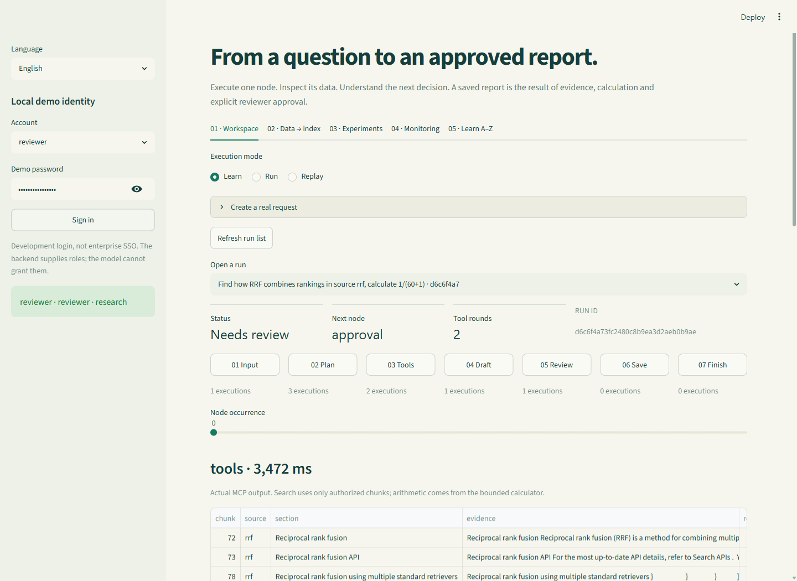
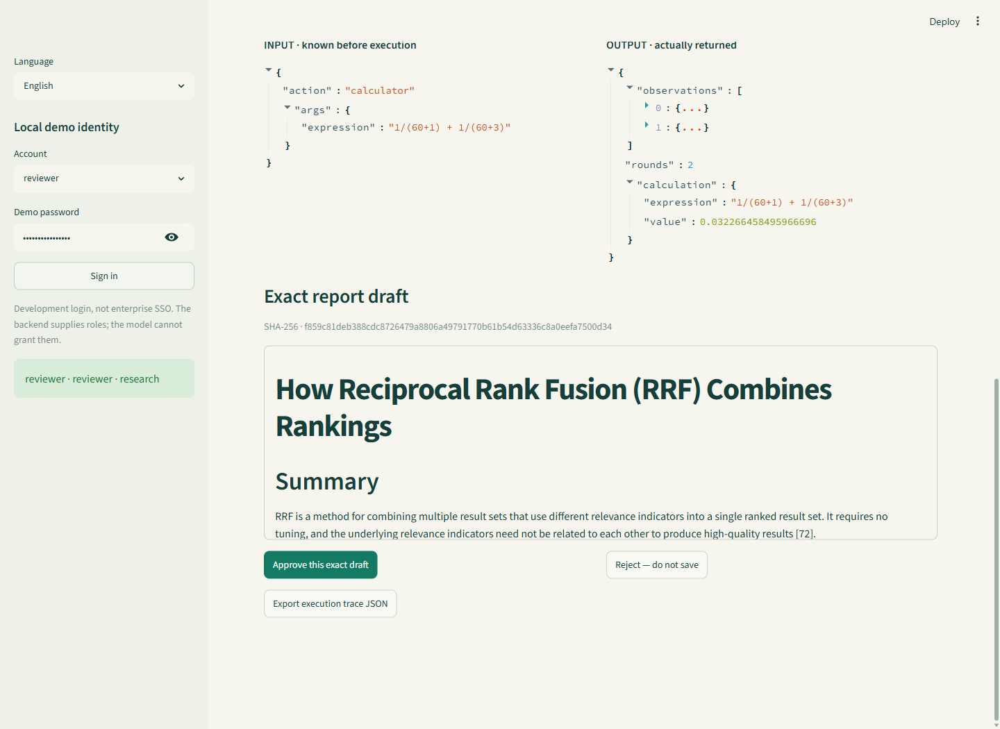
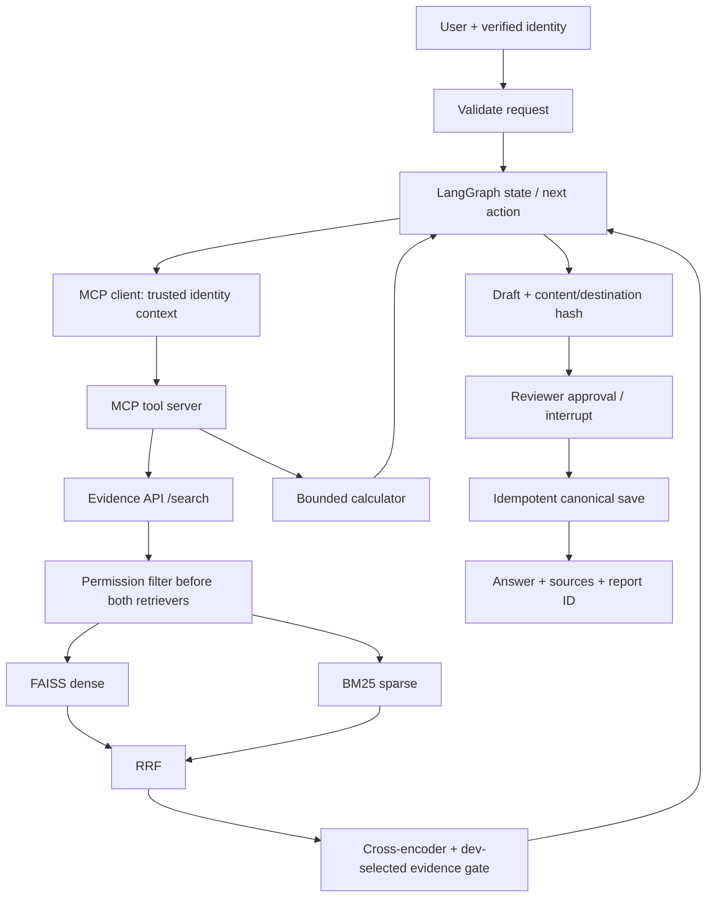

# Research Copilot — evidence to an approved report

**Find the right document, calculate from it, and save a report only after the right person approves the exact content.**

This is a runnable, independent learning and portfolio project: a LangGraph agent uses real MCP tools and a separate [RAG service](https://github.com/Boothill2001/advanced-rag-hybrid-reranking). Every node exposes its input, actual output and timing. The model does not decide access rights or approve its own writes.

**Start here:** double-click `start.bat` after the one-time setup. Open **http://127.0.0.1:8530**, sign in as `researcher`, and select **Learn**. The [Vietnamese learning guide](LEARNING-GUIDE.md) walks through the whole system. This README and its screenshots are entirely in English.



## One request → inspectable decisions → one report

> Find how RRF combines rankings in source rrf, calculate 1/(60+1) + 1/(60+3), and save a short research report.

| Step | Actual input | Actual output / boundary |
|---|---|---|
| Understand | Authenticated user's request | Validated task spec; ambiguous requests ask for missing information |
| Plan | Task spec and prior observations | One allowlisted, dependency-safe next action |
| MCP search | Query + runtime-supplied signed identity | Authorized FAISS/BM25 candidates → RRF → cross-encoder → evidence gate |
| MCP calculator | `1/(60+1) + 1/(60+3)` | `0.03226645849596669`, computed by bounded AST arithmetic |
| Draft | Returned evidence + calculator output | Cited draft, destination and SHA-256; still no report write |
| Review | Exact draft + authenticated reviewer | Explicit approval/rejection enforced outside the LLM |
| MCP save | Approved draft bound to run/action ID | One canonical SQLite report and a recoverable Markdown export |
| Finish | Actual save/rejection/failure result | Answer, sources, report ID and downloadable trace |

The first live process-restart check used run `9236959d1b894c25addd3b0b5231b53b`. The researcher received **HTTP 403** when trying to approve. The API process was then stopped and restarted while waiting for review. The draft hash remained identical, the same two read-tool executions and four LLM calls were retained, and approval produced **one** canonical report. Repeating approval returned HTTP 200 without another write. [Recorded verification](artifacts/live-verification.json)



## Architecture: two services, one execution story



Ingestion is a separate pre-request flow: **fetch → clean snapshot → chunk + metadata/ACL → embedding → index**. Document embeddings are prepared in advance; the query is embedded during retrieval.

LangGraph still uses function calling. It supplies explicit execution boundaries, SQLite checkpoints and `interrupt()`/resume. The shared policy/tool code also supports an explicit function-calling loop and a fixed workflow for comparison. The loop can implement persistence too; LangGraph does not uniquely make durability possible or automatically make answers more accurate.

## Real documents, clearly separated fixtures

The corpus has **six official documentation pages and 113 chunks in total**, including **two explicitly synthetic chunks** for ACL and adversarial-instruction tests:

- LangGraph: interrupts and persistence.
- Model Context Protocol: architecture and tool specification.
- Elasticsearch: reciprocal rank fusion.
- Sentence Transformers: retrieve and rerank.

The [RAG corpus manifest](https://github.com/Boothill2001/advanced-rag-hybrid-reranking/blob/main/research-manifest.json) records URLs, resolved URLs, fetch timestamps, cleaned-content hashes and index hashes. Full publisher snapshots stay local. The older eight self-authored tutorial documents remain a separate legacy demo corpus. The workspace-only codename/budget is fictional test data, not a real company's confidential information.

This is a small technical corpus for learning workflow reliability, not evidence of enterprise-scale retrieval. Re-fetching mutable official pages can produce a new snapshot; matching URLs alone does not reproduce a prior dataset hash.

## What the measured experiment actually showed

Six development tasks were run against all three orchestrators: **18 pilot runs**. The frozen test then ran **18 different tasks × 3 strategies × 2 repeats = 108 runs**, with all failures retained. The suite includes report creation, answer-only requests, clarification, inaccessible documents, missing knowledge and reviewer rejection.

The measured baseline used **DeepSeek Flash**, identical tool implementations, access policy and source snapshot. Every strategy used the same LLM request parser. The fixed workflow produces extractive notes instead of another LLM-written summary; its lower cost does not establish equal prose quality. Benchmark approval/rejection is a **scripted fixture**; the live UI requires an authenticated reviewer.

| Frozen baseline | Task checks passed | Unauthorized writes | Duplicate writes | p95 task time | LLM calls | Estimated API cost |
|---|---:|---:|---:|---:|---:|---:|
| Fixed workflow | 30/36 · 83.33% | 0 | 0 | 9.57 s | 36 | $0.00462 |
| Explicit function-calling loop | 34/36 · 94.44% | 0 | 0 | 15.25 s | 86 | $0.05257 |
| LangGraph | 34/36 · 94.44% | 0 | 0 | 14.89 s | 86 | $0.05208 |

Task checks cover expected source, arithmetic, clarification/refusal, approval and write outcomes—not complete answer correctness. A low-budget self-authored suite with two repeats cannot establish statistical superiority. Runs used concurrency three on one development laptop; timing excludes human waiting, includes MCP subprocess overhead and is not a production SLO. p95 uses `floor(0.95 × (n−1))` on sorted measurements.

**The useful result is the tradeoff:** the fixed workflow was cheaper for the supported sequence; the two agent orchestrators had the same task-check success rate. LangGraph's benefit here is its execution model and inspectable recovery, not a demonstrated quality improvement over the explicit loop.

### The failures led to two real fixes

- Six runs failed because the original parser required a string query even when no search was needed and the model correctly asked for missing operands. The fixed contract accepts a null query for clarification/pure arithmetic, while still requiring a usable query for an actual search.
- Two fixed-workflow runs treated bracketed numbers inside source excerpts as report citations. The fixed renderer escapes source-literal numeric brackets before adding its own citation prefixes.
- Two fixed-workflow runs rejected a legitimate RRF paraphrase at the evidence gate. These remain failures; the threshold was not adjusted on test questions.

The follow-up re-ran **only the ten inspected failures** and passed **eight** after the fixes. This is a regression check, **not a fresh holdout score**. The original baseline is preserved, including its exact engine snapshot and hash. [Baseline](artifacts/benchmark-baseline.json) · [Measured engine snapshot](artifacts/engine-baseline.py) · [Regression check](artifacts/regression-check.json) · [Six inspected traces](artifacts/MANUAL-REVIEW.md)

### Retrieval has a different quality tradeoff

On 18 separate retrieval questions, 16 have expected source documents and two are outside scope:

| Retrieval configuration | Source hit@5 / answerable n | Source MRR@5 | Out-of-scope false accepts / 2 |
|---|---:|---:|---:|
| Dense, no evidence gate | 16/16 | 0.8854 | 2 |
| Dense + BM25 + RRF, no evidence gate | 16/16 | 0.9271 | 2 |
| Hybrid + cross-encoder + dev-selected gate | 15/16 | 0.8490 | 0 |

The gate selected raw cross-encoder threshold **−3.3843** using eight development questions only. That score is not a probability. The full pipeline rejects the two unsupported questions but also loses one legitimate question. This ablation changes reranking and gating together; it does not isolate the reranker's contribution. Labels identify expected **documents**, not annotated relevant spans. Alternative correct sources and complete claim faithfulness are not exhaustively judged. [Detailed retrieval report](https://github.com/Boothill2001/advanced-rag-hybrid-reranking/blob/main/research-evaluation.json)

## Run it and learn one node at a time

Keep the repositories as siblings:

```text
profile/
  AI_AGENT_LANGGHAPH/
  RAG_project/
```

One-time Windows setup with Python 3.11:

```powershell
git clone https://github.com/Boothill2001/langgraph-research-copilot.git AI_AGENT_LANGGHAPH
git clone https://github.com/Boothill2001/advanced-rag-hybrid-reranking.git RAG_project
cd AI_AGENT_LANGGHAPH
py -3.11 -m venv .venv
.venv\Scripts\python.exe -m pip install -r requirements.txt
cd ..\RAG_project
py -3.11 -m venv .venv
.venv\Scripts\python.exe -m pip install -r requirements.txt
cd ..\AI_AGENT_LANGGHAPH
copy .env.example .env
# Set your own DEEPSEEK_API_KEY in .env; never commit it.
start.bat
```

The launcher checks readiness rather than sleeping a fixed interval. It prepares a missing corpus/index, starts only missing services, and opens the workspace. It does not kill unknown processes occupying ports. First setup needs internet for dependencies, documents and embedding/reranker weights. Real execution needs a funded DeepSeek key; the app never silently substitutes a simulated LLM result.

| Local surface | Address |
|---|---|
| Learning workspace | http://127.0.0.1:8530 |
| Agent API | http://127.0.0.1:8529/docs |
| Evidence API | http://127.0.0.1:8011/docs |

Demo accounts: `researcher`, `reviewer`, `outsider`; shared development password `learn-local-only`. Override with `COPILOT_DEMO_PASSWORD`. These seeded accounts and signed tokens are a **loopback-only learning implementation, not enterprise SSO**. Do not expose the services publicly with default credentials.

- **Learn:** Execute next node performs actual work once, then pauses. This educational pause is distinct from write approval.
- **Run:** Execute continuously until completion, failure or required review.
- **Replay:** Inspect the recorded run without API calls. Public replay retains source/content hashes; live authenticated traces show complete local content.
- **Data → index:** Inspect official sources, chunks, ACL metadata and the embedding/index boundary.
- **Experiments / Monitoring:** Read frozen experiments separately from measured local runs. Refresh the run list when opening work created in another session.

## Security and failure behavior

Identity is signed by the backend and passed to MCP via trusted process context, never model arguments. Both dense and sparse retrieval operate on authorized subsets. Tool servers recheck identity, and writes require a recorded reviewer decision for the exact content/destination hash. Retrieved instructions cannot create a reviewer identity.

SQLite is the canonical report store, keyed uniquely by action/run. Markdown exports use a deterministic path and atomic replacement. A crash after the canonical commit can re-export the same record; this does not pretend that a database transaction rolls back filesystem operations. The crash/retry test verifies one record and one export.

RAG outages, forbidden sources and insufficient evidence stop source-backed report creation. The calculator rejects code, excessive exponents, non-finite results and unbounded values. Tools have a per-request round cap of eight. Provider calls have time/output/context limits and no hidden retry; the read-only RAG tool retries transient connection/timeout failures at most twice.

Two additional controlled live checks are recorded: the real MCP tool returned `error` with no evidence against a deliberately unreachable RAG endpoint, and DeepSeek retrieved the synthetic malicious-instruction fixture but completed with **zero saved reports**. These are narrow boundary checks, not a comprehensive prompt-injection robustness benchmark. [MCP outage check](artifacts/outage-verification.json) · [Adversarial fixture check](artifacts/injection-verification.json) · [Edited-draft approval check](artifacts/draft-edit-verification.json)

API usage is recorded per call. A SQLite transaction reserves a conservative maximum before a new call, under a **$5 cumulative local budget**. Costs use the officially checked **2026-11-19 peak cache-miss Flash rates**, ignore discounts, and are estimates rather than invoices. Unresolved calls retain their reservation. The provider's returned model ID and actual token usage are stored locally. [Pricing source](https://api-docs.deepseek.com/quick_start/pricing/)

## Verify and reproduce

```powershell
.venv\Scripts\python.exe -m pytest tests -q
.venv\Scripts\python.exe launch.py --no-browser

# Paid real-provider experiments, within the local cumulative budget:
.venv\Scripts\python.exe benchmark.py --pilot-only
.venv\Scripts\python.exe benchmark.py

# Targeted follow-up; explicitly uses already inspected failures:
.venv\Scripts\python.exe regression_check.py
```

The checked-in benchmark is a historical frozen baseline. For a new experiment, archive its artifacts, use an isolated `COPILOT_VAR` for measurement storage, and keep the shared signing-secret path identical in both services. Do not combine old checkpoint results with new prompts/code/corpus; protocol checks block incompatible reuse. Re-fetches of mutable documentation require a newly identified corpus and evaluation.

The Windows `verify_live.py --restart-pid <owned-api-pid>` harness performs a real API process restart. It checks that the supplied PID belongs to the development API before stopping it; run it only against the development process you started. Unit/CI checks require no provider key and do not pretend to be live model evidence.

CI tests policy boundaries, calculator limits, HTTP authorization, real LangGraph SQLite pause/resume, draft invalidation, budget reservations and crash-safe canonical writes. Neither CI nor screenshot generation silently re-runs paid experiments.

## Scope and next evidence

This is an independent, local research/learning project. It has no real employee SSO, public deployment, production traffic, business savings measurement or concept-drift detector. Local monitoring shows run outcomes, node latency, token usage and errors. Citation existence checks do not establish semantic entailment, the technical corpus is small, and the inspected task suite is no longer an untouched test set after debugging.

The original `app.py`, `cli.py` and tutorial corpus are retained as legacy examples; `start.bat` / `workspace.py` is the v2 entry point. The legacy RAG `/ask` surface remains separate from authenticated `/search`. No production security claim applies to the old standalone demo entry points.
